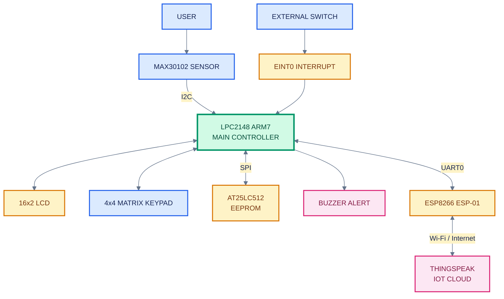
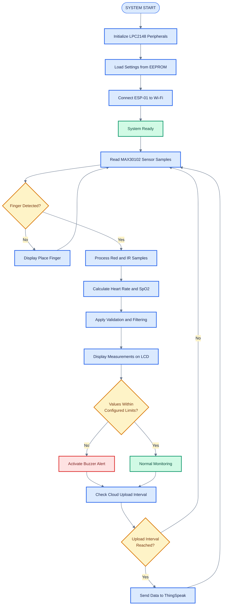
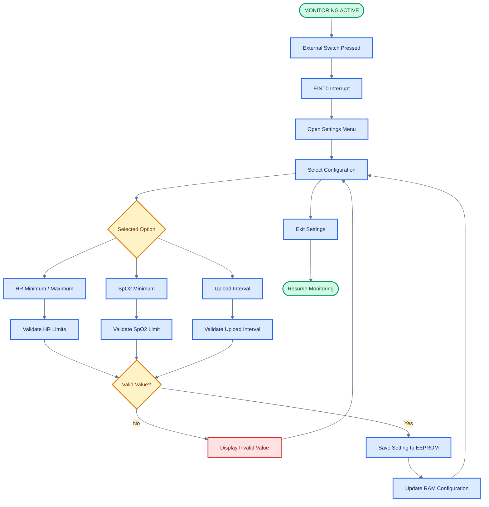
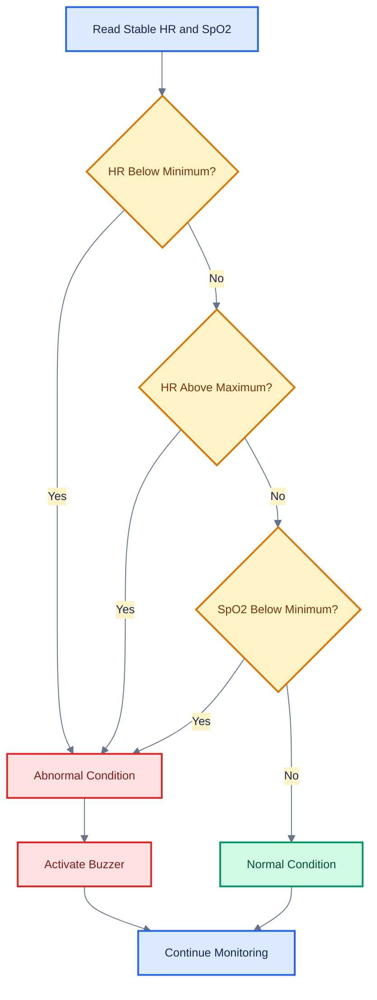

# PulseGuard
### IoT-Based Heart Rate and Blood Oxygen Monitoring System

## Overview

**PulseGuard** is an IoT-based health monitoring system developed using the **LPC2148 ARM7 microcontroller** and Embedded C.

The system measures a person's heart rate (BPM) and blood oxygen saturation (SpO₂) using the MAX30102 pulse oximeter sensor.

The measured parameters are displayed on an LCD and transmitted to the **ThingSpeak IoT cloud platform** through an ESP8266 ESP-01 Wi-Fi module for remote monitoring.

The system also provides configurable safety limits for heart rate and SpO₂. When the measured values cross the configured limits, an alert is generated using a buzzer.

Users can modify monitoring limits and cloud upload intervals through a keypad-based configuration menu. The settings are stored in external EEPROM to retain the configured values even after power is disconnected.

---

## Key Features

- Real-time heart rate monitoring in BPM.
- Blood oxygen saturation (SpO₂) measurement in percentage.
- MAX30102 optical sensor interfacing.
- Finger detection before processing sensor readings.
- Heart rate and SpO₂ calculation using red and IR sensor samples.
- Signal averaging and basic filtering for measurement stability.
- LCD-based measurement display.
- Configurable minimum and maximum heart rate limits.
- Configurable minimum SpO₂ limit.
- Configurable cloud data upload interval.
- Persistent configuration storage using AT25LC512 EEPROM.
- Wi-Fi connectivity using ESP8266 ESP-01.
- ThingSpeak cloud integration for remote monitoring.
- Buzzer alert for abnormal readings.
- External interrupt-based settings menu.
- UART-based communication and debugging.

---

## Hardware Components

| Component | Purpose |
|---|---|
| LPC2148 | ARM7 main microcontroller |
| MAX30102 | Heart rate and SpO₂ sensor |
| 16x2 LCD | Displays monitoring values and settings |
| 4x4 Matrix Keypad | Configuration and menu navigation |
| ESP8266 ESP-01 | Wi-Fi connectivity |
| AT25LC512 | External SPI EEPROM for persistent settings |
| Buzzer | Abnormal-condition alert |
| External Switch | Settings menu request through EINT0 |
| USB-to-UART Converter / DB-9 | Serial communication and debugging |

---

## Communication Protocols

| Protocol | Application |
|---|---|
| I2C | MAX30102 sensor communication |
| SPI | AT25LC512 EEPROM communication |
| UART0 | ESP-01 communication and serial monitoring |
| GPIO | LCD, keypad and buzzer interfacing |
| EINT0 | External interrupt for settings menu |

---

## System Architecture

The following block diagram illustrates the interaction between the sensor, LPC2148 controller, storage, display, alert system and IoT platform.



---

## Monitoring Workflow

The monitoring process begins by initializing the LPC2148 peripherals and loading the previously configured safety limits and upload interval from EEPROM.

The MAX30102 collects red and infrared (IR) samples. These samples are processed to estimate heart rate and SpO₂ values.

The measured values are displayed on the LCD and checked against the configured safety limits. An abnormal condition activates the buzzer.



---

## Sensor Interfacing – MAX30102

The MAX30102 is an integrated optical sensor used to measure heart rate and estimate blood oxygen saturation.

It uses two light sources:

- Red LED
- Infrared (IR) LED

The sensor communicates with the LPC2148 through the I2C protocol.

### Sensor Configuration

| Parameter | Configuration |
|---|---|
| Sensor | MAX30102 |
| Communication | I2C |
| I2C Address | 0x57 (7-bit) |
| Operating Mode | SpO₂ Mode |
| Sample Rate | 100 Hz |
| ADC Range | 4096 nA |
| Pulse Width | 411 µs |
| FIFO Buffer | 500 Samples |

### Measurement Process

1. Initialize the I2C peripheral.
2. Configure the MAX30102 registers.
3. Reset the sensor FIFO pointers.
4. Collect red and IR samples from the FIFO.
5. Check finger presence using IR signal levels.
6. Calculate heart rate using IR signal variations.
7. Estimate SpO₂ using red and IR signal components.
8. Apply basic validation and filtering.
9. Display the calculated values on the LCD.

### Measurement Display

Example:

```text
HR: 78 BPM
SpO2: 97%
```

**Note:** The implemented calculations are basic embedded signal-processing estimates. They are intended for educational and demonstration purposes, not clinical diagnosis.

---

## Configurable Safety Limits

PulseGuard allows users to modify monitoring parameters through a keypad-based settings menu.

The settings menu is requested using an external switch connected to EINT0.

### Settings Menu

| Option | Function |
|---|---|
| 1 | Set minimum heart rate |
| 2 | Set maximum heart rate |
| 3 | Set minimum SpO₂ |
| 4 | Set cloud upload interval |
| 5 | Exit settings menu |

### Configuration Validation

| Parameter | Allowed Range |
|---|---|
| Minimum Heart Rate | 30–200 BPM |
| Maximum Heart Rate | Greater than minimum HR and up to 220 BPM |
| Minimum SpO₂ | 70–100% |
| Upload Interval | 1–3600 seconds |

Invalid values are rejected, and previously stored settings are retained.

---

## Settings Management Workflow



---

## EEPROM Data Management – AT25LC512

The AT25LC512 external EEPROM is interfaced with the LPC2148 using SPI communication.

It stores the user-configurable monitoring parameters so that the settings remain available after a power cycle.

### EEPROM Memory Organisation

| Memory Address | Stored Parameter |
|---|---|
| 0 | Minimum Heart Rate |
| 1 | Maximum Heart Rate |
| 2 | Minimum SpO₂ |
| 3 | Upload Interval – Low Byte |
| 4 | Upload Interval – High Byte |

### EEPROM Operations

- Byte write.
- Byte read.
- Page write.
- Write enable and write disable.
- Write-in-progress status checking.

The firmware uses byte-level read and write operations for updating the configuration values.

---

## IoT Connectivity – ESP8266 ESP-01

The ESP8266 ESP-01 module provides Wi-Fi connectivity for remote health monitoring.

The LPC2148 communicates with the ESP-01 through UART0 using AT commands.

### Wi-Fi Communication Process

1. Initialize UART communication.
2. Check ESP-01 response using AT commands.
3. Disable command echo.
4. Configure single-connection mode.
5. Connect to the configured Wi-Fi access point.
6. Establish a TCP connection with the ThingSpeak server.
7. Send heart rate and SpO₂ measurements using an HTTP request.
8. Close the TCP connection after transmission.

### ThingSpeak Cloud Integration

PulseGuard uses the ThingSpeak IoT platform to receive and visualize monitoring data.

| Channel Field | Data |
|---|---|
| Field 1 | Heart Rate (BPM) |
| Field 2 | Blood Oxygen Saturation (SpO₂ %) |

Example data:

```text
Heart Rate : 78 BPM
SpO2       : 97%
```

The cloud upload interval can be configured through the keypad menu and stored in EEPROM.

**Security Note:** Wi-Fi credentials and ThingSpeak Write API keys should be configured privately. Never publish actual passwords or API keys in a public GitHub repository.

---

## Alert System

The system continuously compares the measured parameters against the configured safety limits.

An alert is generated when:

- Heart rate falls below the configured minimum.
- Heart rate exceeds the configured maximum.
- SpO₂ falls below the configured minimum.

### Alert Logic



---

## Firmware Architecture

The firmware is developed using Embedded C with modular peripheral drivers and application-level functions.

The source archive contains the following modules:

| Source File | Responsibility |
|---|---|
| `main_pg.c` | Main application initialization and monitoring loop |
| `main_test.c` | Alternative main application and timer-based upload test |
| `project_pg.h` | Common data types and function declarations |
| `all_defines.h` | Pin definitions, register bits and configuration constants |
| `MAX.c` | MAX30102 initialization, FIFO reading, finger detection, HR and SpO₂ calculation |
| `menu_pg.c` | Monitoring display, settings menu and limit management |
| `lcd.c` | LCD initialization and display functions |
| `kpm.c` | Keypad scanning and numeric input |
| `i2c.c` | I2C peripheral initialization and communication |
| `spi.c` | SPI0 initialization and data transfer |
| `spi_eeprom.c` | AT25LC512 EEPROM read and write operations |
| `uart0.c` | UART0 initialization and communication |
| `uart0_test.c` | UART0 interrupt and communication testing |
| `esp01.c` | ESP-01 communication routines |
| `esp01_test.c` | ESP-01 Wi-Fi and ThingSpeak communication testing |
| `esp01_test2.c` | Additional ESP-01 integration and communication routines |
| `timer0.c` | Timer0 initialization and interrupt handling |
| `Timer1.c` | Timer1 initialization and interrupt handling |
| `rtc.c` | RTC initialization and time-related functions |
| `interrupt_pg.c` | EINT0 interrupt configuration and settings-menu request |
| `mcp3204.c` | MCP3204 ADC interfacing utility |
| `delay.c` | Software delay functions |

---

## LPC2148 Peripheral Pin Configuration

The following pin assignments are derived from the supplied source definitions.

| LPC2148 Pin | Peripheral | Function |
|---|---|---|
| P0.0 | UART0 | TX |
| P0.1 | UART0 | RX |
| P0.2 | I2C | SCL |
| P0.3 | I2C | SDA |
| P0.4 | SPI0 | SCK |
| P0.5 | SPI0 | MISO |
| P0.6 | SPI0 | MOSI |
| P0.7 | SPI0 / GPIO | EEPROM Chip Select |
| P0.8–P0.15 | GPIO | LCD Data Bus D0–D7 |
| P0.18 | GPIO | LCD RW |
| P0.22 | GPIO | LCD RS |
| P0.23 | GPIO | LCD Enable |
| P0.16 | EINT0 | Settings Switch |
| P1.16–P1.19 | GPIO | Keypad Rows |
| P1.20–P1.23 | GPIO | Keypad Columns |
| P0.20 | GPIO | Buzzer |

---

## Development Environment

| Tool / Technology | Purpose |
|---|---|
| Keil µVision | Embedded C development and compilation |
| LPC2148 | Target microcontroller |
| Embedded C | Firmware development |
| MAX30102 | Optical sensor interfacing |
| ESP8266 ESP-01 | Wi-Fi communication |
| ThingSpeak | IoT cloud monitoring |
| Flash Magic | Microcontroller programming |
| Serial Terminal | UART testing and debugging |

---

## Build and Programming

1. Open the firmware project in Keil µVision.
2. Select the LPC2148 microcontroller.
3. Add the required `.c` source files to the project.
4. Include the corresponding header files.
5. Configure the target clock and compiler settings.
6. Verify the peripheral pin configurations.
7. Compile and build the firmware.
8. Resolve any compilation or linker errors.
9. Generate the HEX firmware file.
10. Program the LPC2148 using Flash Magic.
11. Connect the MAX30102, EEPROM, LCD, keypad and ESP-01.
12. Configure Wi-Fi credentials and ThingSpeak channel details.
13. Monitor the sensor readings and cloud updates.

---

## Repository Contents

This GitHub repository is intended to contain the Embedded C source files and header files required for the PulseGuard project.

### Included Files

- `.c` – Embedded C source files.
- `.h` – Header files.
- `README.md` – Project documentation.

### Development and Testing Artifacts

The following are generated or testing-related artifacts and are mentioned for reference only:

- HEX firmware output.
- UART testing output.
- ESP-01 communication test output.

These files are not part of the source-only repository upload.

---

## Project Highlights

- Developed Embedded C firmware for the LPC2148 ARM7 microcontroller.
- Interfaced the MAX30102 optical sensor using I2C.
- Implemented red and IR sensor data acquisition.
- Developed basic heart rate and SpO₂ calculation routines.
- Implemented finger detection and measurement validation.
- Integrated AT25LC512 EEPROM using SPI.
- Developed configurable monitoring limits with persistent storage.
- Integrated ESP8266 ESP-01 for Wi-Fi connectivity.
- Implemented ThingSpeak cloud data transmission.
- Developed buzzer-based abnormal-condition alerts.
- Implemented interrupt-based configuration menu access.
- Used modular peripheral drivers for embedded system development.

---

## Project Information

| Category | Details |
|---|---|
| Project Name | PulseGuard |
| Project Type | IoT-Based Health Monitoring |
| Controller | LPC2148 |
| Architecture | ARM7 |
| Programming Language | Embedded C |
| Programming Approach | Register-Level / Bare-Metal |
| Sensor | MAX30102 |
| EEPROM | AT25LC512 |
| Wi-Fi Module | ESP8266 ESP-01 |
| Cloud Platform | ThingSpeak |
| Communication | I2C, SPI, UART, GPIO |
| Development IDE | Keil µVision |
| Programming Tool | Flash Magic |

---

## Important Disclaimer

PulseGuard is an educational embedded systems and IoT project. The sensor readings and implemented calculation algorithms are intended for demonstration and learning purposes only.

This project is not a certified medical device and must not be used for medical diagnosis, treatment decisions or emergency monitoring.

---

**PulseGuard – IoT-Based Heart Rate and Blood Oxygen Monitoring System**

*Designed and developed using LPC2148 ARM7, Embedded C and IoT technologies.*
